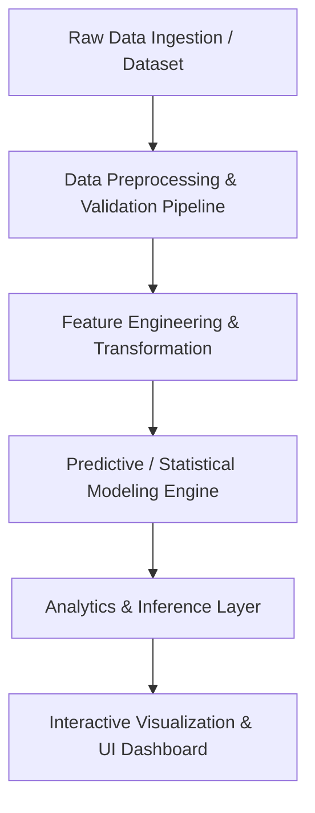

# System Architecture

## 1. Overview
The **Poll Results Visualizer** is designed to ingest, process, model, and visually present poll and survey analytics across diverse use cases—including customer satisfaction, employee feedback, product preferences, academic polls, and election studies.

---

## 2. Architectural Layers

### 2.1 Ingestion & Pipeline Layer
- Responsible for reading tabular/streaming survey responses or aggregate polling statistics.
- Validates data schema, handles missing values, and detects anomalies.

### 2.2 Feature & Processing Layer
- Normalization, one-hot/ordinal encoding, demographic grouping, and temporal weighting.
- Aggregation across demographics, segments, geographic regions, or response choices.

### 2.3 Model & Analytics Engine
- Houses statistical algorithms (e.g., Bayesian polling aggregators, trend smoothers) or ML models for outcome prediction and margin estimation.

### 2.4 Presentation & Visualization Layer
- Renders responsive charts (bar, line/trend, distribution, choropleth maps) and interactive breakdown widgets.

---

*(Note: Layer details will be updated with exact module signatures as implementations begin.)*
