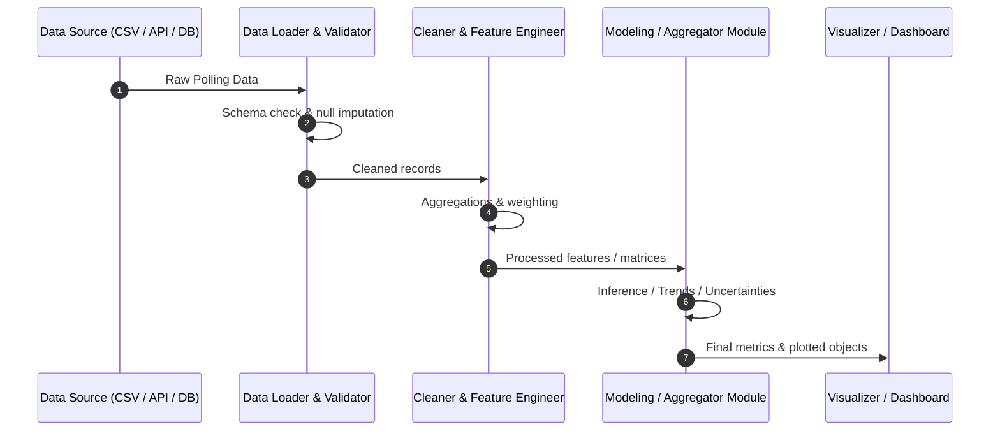

# Data Pipeline & Flow

## 1. Dataset Specifications
*Details of dataset selection, fields, source, and schema will be recorded here.*

| Attribute | Type | Description | Constraints / Notes |
| :--- | :--- | :--- | :--- |
| *TBD* | *TBD* | *Awaiting dataset ingestion definition* | *TBD* |

---

## 2. End-to-End Data Flow

---

## 3. Data Transformations & Quality Checks
- **Schema Validation**: Ensures all expected columns and data types exist.
- **Handling Missing Values**: Strategy for unassigned votes, non-responses, or missing demographic tags.
- **Weighting & Normalization**: Adjustments for sample bias, pollster ratings, or date recency decay.
